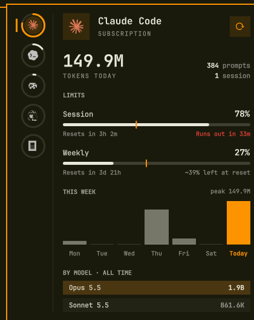

# Agent Usage

[](https://github.com/LizinDev/omarchy-agent-usage/actions/workflows/ci.yml)
[](LICENSE)
[](https://omarchy.org/)

Usage, limits and pace for every AI coding agent on the machine, in one panel
on the [Omarchy](https://omarchy.org/) 4 bar: Claude Code, Codex and Fireworks
like the built-in panel, plus **OpenCode, GitHub Copilot and Hermes** through
collectors this plugin bundles.

Omarchy is an Arch Linux and Hyprland desktop setup by DHH. This plugin is a
fork of its built-in **Agents** panel (`omarchy.agents`, Omarchy 4.0.5) and
replaces it in place.



## What it adds

- **A panel built for many agents.** Every agent sits on a rail down the left
  edge, ringed by its fullest limit, so the whole picture reads at a glance and
  nothing truncates. The page beside it opens on today's tokens in large type,
  then the limits with a pace marker and a forecast (what the current pace
  leaves at the reset, or when it runs out), the week as columns, and the
  models.
- **Three more agents.** OpenCode (the 2.x database included), the GitHub
  Copilot CLI (with your real Copilot quota as limits) and the Hermes Agent
  each get a place on the rail, with tokens by day and by model.
- **One refresh for everything.** The panel's own refresh runs Omarchy's
  collectors and the bundled ones together, so `r` in the panel, the refresh
  timer and opening the panel cover every agent. No systemd timer to install.
- **Numbers checked against an oracle.** Each bundled collector was compared
  with an independent count of the same source before it shipped (see
  [Accuracy](#accuracy) and the [devlog](DEVLOG.md)).
- **A drop-in replacement.** The manifest declares
  `omarchy.clonedFrom: "omarchy.agents"`, the convention `omarchy plugin
  clone` uses: enabling the plugin swaps the built-in out of its spot in the
  bar, and anything that still calls `omarchy.agents` reaches this panel.

The data model, prepaid balances and cross-device sync are the built-in
panel's, unchanged.

## Using it

- **Bar icon:** left click opens the panel, right click launches an agent
  (`omarchy-agent --pick`), middle click shows the next agent.
- **Panel:** click an agent on the rail or press `h`/`l` to switch, `j`/`k`
  scroll, `r` or Enter refreshes (so does the tinted button in the corner),
  Tab moves to the neighboring bar panel, Esc closes.
- **Rail:** each ring is the agent's fullest limit (accent on the agent shown,
  red from 90%); hover a disc for its name, that limit and today's tokens. It
  sits on the same side as the widget in the bar.
- **Limits:** the share used, a meter whose accent tick marks how far the
  window's clock has run (fill past the tick means ahead of pace), the reset
  countdown and a forecast: `~39% left at reset`, or `Runs out in 33m` in red.
- **This week:** one column per day scaled to the busiest, today in the
  accent; hover a column for its tokens (today adds prompts and sessions).
- **By model:** all-time, heaviest first; hover for the input, output and cache
  split.
- **IPC:** `omarchy-shell agent-usage <open|close|toggle|refresh|next>`, or
  `omarchy-shell shell toggle omarchy.agents '{}'`, which the shell routes
  here while this plugin is enabled.

An agent shows up once it has recorded usage; one that never ran here stays
off the rail, and with nothing to show the icon leaves the bar.

## Agents and where the numbers come from

| Agent | Collector | Tokens | Limits |
|---|---|---|---|
| Claude Code | Omarchy's | `~/.claude/projects` transcripts | Anthropic OAuth usage (5-hour, weekly) |
| Codex | Omarchy's | `~/.codex/sessions` rollouts | `codex app-server` RPC |
| Fireworks | Omarchy's | Fireworks billing API | estimated prepaid balance |
| OpenCode | bundled | `opencode.db`: 2.x `session_message`/`session_v2`, 1.x `message` for sessions 2.x never migrated | OpenCode Go, when signed in |
| Copilot | bundled | `~/.copilot/session-state/*/events.jsonl` | `api.github.com/copilot_internal/user` with your `gh` token |
| Hermes | bundled | `~/.hermes/state.db` (`session_model_usage`) | none (Hermes has no quota source) |

Every collector writes one JSON record to
`~/.local/state/omarchy/agents/usage/<agent>.json`; the panel draws whatever
lands there. The bundled collectors read their sources read-only, count
messages without reading their text, and keep their last good record when a
source cannot be read.

When an Omarchy release ships its own collector for one of these agents
(upstream added OpenCode, Copilot and Hermes in October 2026), the bundled
copy steps aside and Omarchy's owns the record.

## Accuracy

The bundled collectors follow the conventions of Omarchy's own: output
includes reasoning tokens, a day is a local date, and limits are a 0–1
fraction. The details that are easy to get wrong:

- **OpenCode.** 2.x sessions migrated from 1.x live in both tables; each
  session is counted once. A session's totals also include calls that leave
  no message row (the title request), and that remainder is counted on the
  session's own model. Checked against `session_v2` totals: equal for every
  model.
- **Copilot.** `inputTokens` already includes cache reads and writes, and
  `outputTokens` already includes reasoning; a subagent's calls already appear
  as their own usage records. None of these is added twice. Sessions from CLIs
  older than per-call records (≤ 1.0.86) fall back to the session's shutdown
  snapshot. Premium requests come from the session's accounting, not from
  summing per-call costs. Checked against the shutdown snapshots: equal.
- **Hermes.** `session_model_usage` includes auxiliary calls (title
  generation, background review) that the session totals leave out, so it is
  the source; a subagent's opening turn is not counted as a prompt. Checked
  with SQL and with a second, independent implementation: equal.

## Privacy

Everything is read and computed on your machine. The bundled collectors open
their sources read-only and count tokens, messages and sessions; they never
read prompt or response text, and the records hold only numbers, model names
and plan names. Two collectors make network requests, both to the service the
quota belongs to: Copilot asks `api.github.com` for your quota with the token
`gh` already holds, and OpenCode asks `opencode.ai` for OpenCode Go limits when
you are signed in to Go. Omarchy's own collectors do the same for Claude, Codex
and Fireworks.

## Install

```bash
omarchy plugin add https://github.com/LizinDev/omarchy-agent-usage.git --enable --yes
```

`--enable` puts it where the built-in Agents panel was. Requirements:
Omarchy 4 (tested on 4.0.5), `python3`, and `gh` signed in for Copilot
limits.

From a checkout:

```bash
make install
omarchy plugin enable io.github.lizindev.agent-usage
omarchy restart shell
```

To go back to the built-in panel:

```bash
omarchy plugin remove io.github.lizindev.agent-usage
omarchy plugin enable omarchy.agents
```

## Settings

The same keys as the built-in panel, in this widget's entry in
`~/.config/omarchy/shell.json` (numbers need `--json`):

| Key | Default | What it does |
|---|---|---|
| `providers.<id>.enabled` | `true` | `false` hides that agent and stops its collector |
| `refreshIntervalSec` | `900` | How often every record regenerates |
| `syncMode` | `"Off"` | `"On"` writes this machine's snapshot and merges the others |
| `syncDir` | `""` | A folder synced by Syncthing, Dropbox, rsync, … |
| `syncFileName` | `<hostname>.json` | This machine's snapshot file |
| `syncDeviceId` | hostname | Stable device name inside the snapshot |

```bash
omarchy bar set io.github.lizindev.agent-usage refreshIntervalSec 300 --json
```

## Known issues in Omarchy 4.0.5's own collectors

Found while checking this plugin's numbers; they live in Omarchy's packaged
collectors, not here.

- **Codex limits flicker to "account/read".** `codex app-server` 0.163 holds
  the answer to `account/read` when the request arrives while it is still
  loading the account, and only sends it with the next request; the
  collector gives up after 4 s (5 failures in 6 runs). The patch in
  [`patches/`](patches/) sends both requests before waiting (6 in 6). It
  edits a packaged file, so reapply it after Omarchy updates:
  `sudo patch /usr/bin/omarchy-agent-usage-codex < patches/codex-account-read-race.patch`.
- **Claude output tokens read about 5% low.** A message spans several
  transcript lines that share its id; the collector keeps the first, whose
  usage can be partial.
- **OpenCode 2.x sessions on Anthropic or OpenAI providers** are invisible to
  the Claude and Codex collectors, which read only the 1.x table. Until they
  read `session_message`, the OpenCode view counts those sessions, named
  `<model> · <provider>`.
- **`codex exec --ephemeral`** saves no session, so that usage never reaches
  the Codex view.

## Development

```bash
make dev      # install into ~/.config/omarchy/plugins and restart the shell
make check    # lint (Python, shell, QML), tests, manifest validation
```

[CONTRIBUTING.md](CONTRIBUTING.md) covers the layout, the rules every
collector keeps and how to release. [CHANGELOG.md](CHANGELOG.md) lists what
changed in each version, and [DEVLOG.md](DEVLOG.md) records what was found
and decided along the way.

## License

MIT. The panel (`Panel.qml`, `Main.qml`, `Agent.qml`) and the agent marks in
`assets/` (the OpenCode, Copilot and Hermes ones from Omarchy's `quattro`
branch) come from [Omarchy](https://github.com/omacom/omarchy), © David
Heinemeier Hansson; the collectors, the runner and the changes are © 2026
Pedro Henrique Braz Moreira. See [LICENSE](LICENSE).
